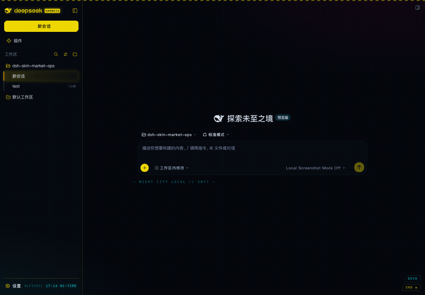

# dsh-theme-cyberpunk2077 — NIGHT CITY EDITION

[](LICENSE)
[](https://www.npmjs.com/package/dsh-theme-cyberpunk2077)
[](https://dshfind.com/zh/plugins/Tommy00748/dsh-theme-cyberpunk2077)

> 欢迎来到夜之城。你的 DeepSeek Harness 已经被改装过了。

Cyberpunk 2077（夜之城）风格的 DSH Web UI 主题。纯浏览器客户端插件，零音频资源——所有声音都是 Web Audio 实时合成，不下载一个字节的音频文件。



## ✨ 这是什么

一个把 DSH Web 界面整个搬进 2077 年的主题：夜之城黄 × 霓虹青的配色、CRT 扫描线、Kiroshi 义眼式悬停锁定、战斗状态的 HUD、合成音效……以及两个只有夜之城老司机才知道的彩蛋。

所有的效果都可以关——动画、音效、干扰，一个按钮的事。它在小屏幕上和「减弱动态效果」系统设置下也会自动收敛，不会烦你。

## ⚡ 快速上手

```bash
dsh plugin --profile web add dsh-theme-cyberpunk2077
```

然后把主题行挂进 profile 补丁层（`~/.dsh/profiles/web/cordis.patch.yml`）：

```yaml
- insert:
    - id: ui-theme-cyberpunk
      name: 'dsh-theme-cyberpunk2077'
```

重启 `dsh web`，NIGHT CITY 开机转场之后，欢迎来到 2077。

> 💡 **装不上 / 启动崩溃？** 确认装的是 **≥ 0.1.4**（`npm view dsh-theme-cyberpunk2077 version`）。0.1.3 及更早版本发布时漏打了 `cordis.patch.yml`，安装后会因找不到补丁文件启动失败——升级到 0.1.4 即可。

> 想微调？右下角 `DECK` 按钮打开控制面板，每个特效独立开关；`SND` 一键静音全部。

## 🌆 视觉：夜之城的皮

- **配色**：NC 黄 `#FCE300` / 霓虹青 `#00F0FF` / 玫红 / 近黑夜蓝底——夜之城广告牌的味道
- **切角按钮**（45° chamfer），主按钮霓虹脉冲呼吸，像一块通电的电路板
- **CRT 层**：扫描线 + 城市网格 + 双色霓虹雾，复古显示器既视感（可关）
- **Logo 故障动画**：红青 RGB 色散，每 5.5 秒裂一次
- **开机转场**：CRT 开机线 → glitch 条纹 → NIGHT CITY 标题 → 白闪（可关）。每个标签页只播第一次，刷新/断线重连不重播
- **会话 = 数据碎片**：每条会话按稀有度上色（白/绿/青/紫/橙循环），激活的会话是传奇级橙黄光
- **Kiroshi 光学锁定**：悬停会话行，青色扫描线扫过 + 四角瞄准括号——像义眼在锁定目标
- **警示纹**：错误通知顶部红黑 45° 斜纹、面板标题青色斜纹，危险区一眼可辨
- **夜之城时钟 + 数据流**：左下角 `0x93E2E4 23:47 NC-TIME` 一行 HUD 读出，侧栏收起自动隐藏
- **任务追踪器**：目标栏变成 ◈ OBJECTIVE，统计条变成 HUD 读出（⟨ ⟩）
- **通知改版**：切角 + 黄边 + 滑入发光，错误红边——像来了一条 gig 提醒
- **空状态文案**：— NIGHT CITY LOCAL // 2077 —
- **字体**：MiSans（小米，jsDelivr 按 unicode-range 分片加载）+ 本地等宽栈（代码）

## 🎧 声音：合成出来的赛博氛围

- **打字机音效**：每个键一声合成机械声（噪声瞬态 + 降频体），空格/回车更低沉（可关）
- **消息音效闭环**：发送（上行双音）/ 完成（双短音）/ 错误（故障蜂鸣）/ 通知（高频双音）（可关）
- **生成中 = 战斗状态**：`PROCESSING_` 下方出现体力条式脉冲进度；每 6 秒轮换一条夜之城风格加载提示；标签页标题变成 `▶ NC-JOB //`
- **俚语状态条**：发送 `GIG UP // 单子已发` / 完成 `PREEM. // 任务完成`（绿）/ 错误 `FLATLINE // 连接中断`（红）
- **EXECUTE ⏎ 悬停提示**，主发送键悬停时红青 RGB 分离故障
- **标签页接管**：favicon 变成黄色切角方块，标题 `DSH // NC-TERMINAL`（偶尔错字闪烁）

## 🥚 彩蛋：夜之城的秘密

- 在输入框输入 `relic` 并发送 → **「WAKE UP, SAMURAI. WE HAVE A CITY TO BURN.」** 全屏故障时刻
- 在输入框输入 `johnny` 并发送 → 强尼·银手夺屏 2.6 秒：全屏去饱和 + 红青色散 + 画面撕裂 + 随机台词（中英双语）+ 低频嗡鸣


（系统开启「减弱动态效果」时，彩蛋会自动收敛，不吓你一跳。）

## 🛡️ 性能护栏

- 小屏（≤768px）：自动关闭扫描线、数据流和重动画
- `prefers-reduced-motion`：停掉全部循环动画
- 所有特效都能在 `DECK` 面板独立关闭，偏好存 localStorage

## 📁 项目结构

```
package.json     # dsh.bundle + dsh.client manifest（platform: web）
cordis.patch.yml # 一键安装的补丁层
lib/index.js     # 宿主端（空壳，让插件行挂载）
lib/client.js    # 浏览器 bundle：主题 + 全部子系统
assets/          # README 截图
```

## 🧹 想卸载？

把 `cordis.patch.yml` 里的 `ui-theme-cyberpunk` 行删掉，再移除依赖并重启 `dsh web` 即可。夜之城随时欢迎你回来。

> ⚠️ **`dsh plugin rm` 的已知坑**：它不会自动清掉 `cordis.patch.yml` 里已插入的主题行。卸载后如果重启 `dsh web` 报找不到包，手动删掉 profile 补丁里的 `ui-theme-cyberpunk` 行（见上），再重启一次就好。另注意 `0.1.3` 及更早版本存在安装即崩溃的问题，卸载请认准 `0.1.4+`。

## 📜 许可证

MIT — 拿去改装，Night City 不搞版权审查。
